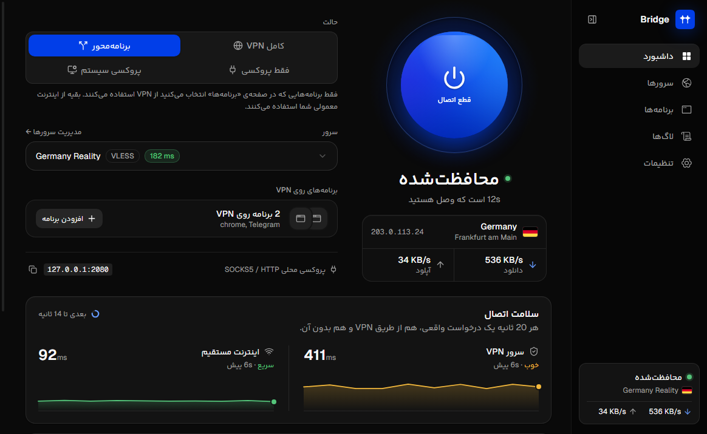
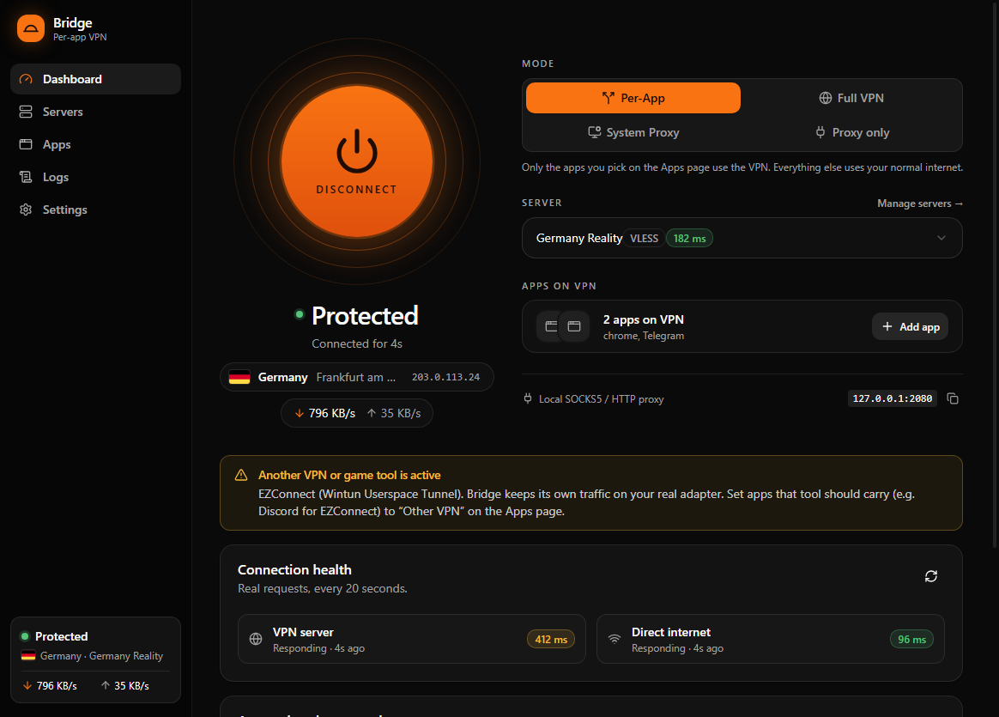
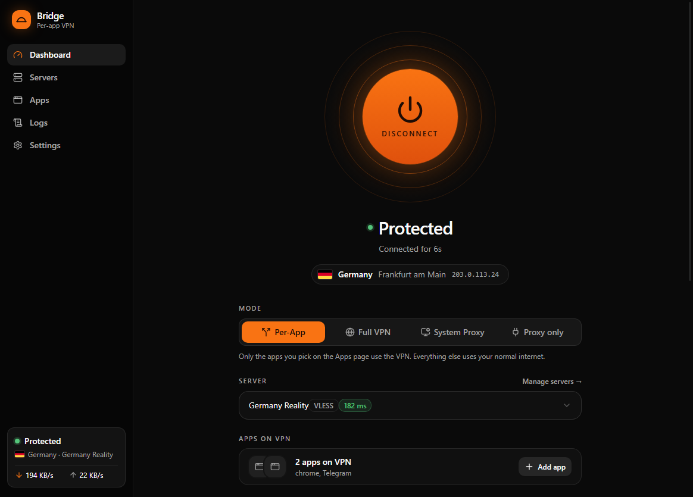

<div dir="rtl">

# Bridge

[English](README.md) · **فارسی**

یک کلاینت VPN برای ویندوز با **مسیریابی برنامه‌محور**: خودتان انتخاب می‌کنید کدام برنامه‌ها از VPN رد شوند و بقیه با اینترنت معمولی کار کنند. به دو زبان فارسی و انگلیسی.



## دانلود

آخرین نسخه را از [Releases](https://github.com/m4hdisa/Bridge-app/releases/latest) بگیرید (`Bridge.Setup.x.y.z.exe`، ویندوز ۱۰ و ۱۱، ۶۴ بیتی). برای به‌روزرسانی، روی نسخه‌ی قبلی نصب کنید؛ سرورها و تنظیمات می‌مانند. از آن به بعد Bridge خودش را به‌روز می‌کند: وقتی نسخه‌ی جدید بیاید، دکمه‌ی **Install and restart** را نشان می‌دهد.

حالت‌های «برنامه‌محور» و «VPN کامل» به دسترسی مدیر (Administrator) نیاز دارند. هر وقت لازم باشد، Bridge دکمه‌ی «اجرای دوباره با دسترسی مدیر» را نشان می‌دهد.

زبان برنامه را از **Settings → Language** عوض کنید.

## امکانات

- **پروتکل‌ها:** VLESS (Reality، XTLS Vision، xhttp، VLESS Encryption)، VMess، Trojan، Shadowsocks، Hysteria2، TUIC.
- **دو هسته:** [sing-box](https://github.com/SagerNet/sing-box) هر کانفیگی را که پشتیبانی کند اجرا می‌کند و [Xray-core](https://github.com/XTLS/Xray-core) کانفیگ‌هایی را که sing-box نمی‌تواند (xhttp، VLESS Encryption، HTTP header روی TCP). Bridge هسته را خودکار انتخاب می‌کند و برای هر سرور می‌توانید عوضش کنید.
- **سرور رایگان WARP:** بدون نیاز به کانفیگ. Bridge با هسته‌ی [Aether](https://github.com/CluvexStudio/Aether) به Cloudflare WARP وصل می‌شود و چند روش را هم‌زمان امتحان می‌کند (MASQUE روی HTTP/3 یا HTTP/2، TLS fragment، IPv6، Gool). می‌توانید **خودکار: سریع‌ترین** یا **خودکار: خروجی خارج از ایران** را انتخاب کنید؛ دومی منتظر Gool می‌ماند که کندتر است. اگر سرویس WARP مسدود باشد، حساب WARP را از طریق یکی از سرورهای خودتان می‌سازد. **Find configs** همه‌ی روش‌ها را تست می‌کند، چند gateway پیدا می‌کند و سرعت هر کدام را می‌سنجد تا اتصال‌های بعدی در چند ثانیه انجام شوند. **اشتراک با دیگران** لینکی با حساب WARP مخصوص خودش کپی می‌کند، تا دوستی که به سرویس ثبت‌نام Cloudflare دسترسی ندارد هم بتواند وصل شود: کافی است لینک را کپی کند و از «افزودن سرور» گزینه‌ی «لینک‌ها از کلیپ‌بورد» را بزند.
- **کلید WARP+ خودتان:** اگر اشتراک WARP+ دارید، روی آیکون کلید در کارت WARP رایگان بزنید و کلید برنامه‌ی 1.1.1.1 را وارد کنید. کلید فقط به Cloudflare فرستاده می‌شود و Bridge آن را نگه نمی‌دارد. WARP+ ممکن است سریع‌تر باشد، ولی مسدود شدن WARP را سخت‌تر نمی‌کند.
- **اشتراک‌های بیشتر:** علاوه بر لینک‌های معمولی، Bridge فایل‌های کامل JSON مربوط به Xray، sing-box و Clash را هم می‌خواند و تنظیمات fragment را نگه می‌دارد. برای [BPB Panel](https://github.com/bia-pain-bache/BPB-Worker-Panel) می‌توانید هر لینک اشتراک پنل یا خود آدرس پنل را اضافه کنید. اشتراک‌هایی که فقط WireGuard دارند وارد نمی‌شوند.
- **کانفیگ‌های عمومی رایگان (تا وقتی روشن نکنید خاموش است):** از «افزودن سرور»، گزینه‌ی کانفیگ‌های عمومی رایگان [فهرستی که هر روز ساخته و تست می‌شود](https://github.com/m4hdisa/Bridge-configs) و فهرست‌های عمومی دیگر را از GitHub می‌گیرد، حدود ۴۰۰ کانفیگ را روی شبکه‌ی خودتان تست می‌کند و تا ۸ کانفیگ را، سریع‌ترین‌ها اول، نگه می‌دارد که واقعاً HTTPS را رد می‌کنند، خروجی‌شان خارج از ایران است و پایدار جواب می‌دهند. **معلوم نیست این سرورها را چه کسی اداره می‌کند.** آن‌ها آی‌پی شما و سایت‌هایی را که باز می‌کنید می‌بینند، پس فقط برای وصل شدن به اینترنت و گشت‌وگذار معمولی از آن‌ها استفاده کنید، نه برای ورود به حساب‌ها یا کارهای حساس. Auto فقط وقتی سراغشان می‌رود که سرور دیگری نداشته باشید. فهرست‌ها: [barry-far](https://github.com/barry-far/V2ray-Config)، [MatinGhanbari](https://github.com/MatinGhanbari/v2ray-configs)، [Danialsamadi](https://github.com/Danialsamadi/v2go)، [Rayan-Config](https://github.com/Rayan-Config/C-Sub)، [TGParse](https://github.com/Surfboardv2ray/TGParse)، [hamedcode](https://github.com/hamedcode/port-based-v2ray-configs)، [nyeinkokoaung404](https://github.com/nyeinkokoaung404/V2ray-Configs)، [V2RayAggregator](https://github.com/mahdibland/V2RayAggregator).
- **چهار حالت اتصال:**
  - **برنامه‌محور:** فقط برنامه‌هایی که انتخاب می‌کنید از VPN استفاده می‌کنند.
  - **VPN کامل:** کل سیستم از VPN رد می‌شود.
  - **پروکسی سیستم:** پروکسی ویندوز را تنظیم می‌کند.
  - **فقط پروکسی:** یک پروکسی محلی SOCKS5/HTTP روی `127.0.0.1:2080`، بدون هیچ تغییری در سیستم.
- **قوانین برنامه‌ها:** هر برنامه را روی VPN، مستقیم، VPN دیگر (سپردن به یک ابزار VPN یا بازی دیگر که در حال اجراست) یا مسدود بگذارید. تغییرات فوری و بدون اتصال دوباره اعمال می‌شوند.
- **اشتراک‌ها:** حجم و روزهای باقی‌مانده و تعداد کانفیگ‌ها را نشان می‌دهد و خودکار به‌روز می‌شود. اگر پنل اطلاعات مصرف را نفرستد، Bridge آن را از اسم کانفیگ‌ها می‌خواند.
- **کنار VPNهای دیگر:** تنظیمات پیش‌فرض برای کامپیوتری است که VPN یا ابزار بازی دیگری باز ندارد. اگر Bridge چنین ابزاری را تشخیص دهد (WARP، VPNهای بازی مثل EZConnect)، ترافیک خودش را از آن دور نگه می‌دارد و با یک کلیک در داشبورد به تنظیمات سازگار می‌رود.
- **سایت‌های ایرانی مستقیم** باز می‌شوند (`.ir` و فهرست آی‌پی و دامنه‌های ایران).
- **سرور خودکار:** همه‌ی سرورها را در پس‌زمینه پینگ می‌کند. **Auto (بهترین پینگ)** به سریع‌ترین سرور وصل می‌شود و اگر از کار بیفتد، به سرور دیگری می‌رود.
- **ابزارها:** اندازه‌گیری سرعت که نشان می‌دهد آداپتر VPN چقدر از سرعت کم می‌کند، و پیدا کردن MTU مناسب خط شما. اندازه‌گیری سرعت فقط وقتی شروعش کنید به Cloudflare (speed.cloudflare.com) وصل می‌شود.
- **وضعیت زنده:** کاری که Bridge موقع اتصال انجام می‌دهد، تست واقعی پینگ، نمودار سلامت VPN و اینترنت مستقیم، محل خروج VPN با پرچم کشور، سرعت لحظه‌ای و ترافیک هر برنامه.
- **Discord activity:** اتصال شما (سرور، حالت، کشور خروج با پرچم) را در پروفایل Discord نشان می‌دهد. آدرس IP شما هیچ‌وقت نشان داده نمی‌شود. از Settings خاموش می‌شود.
- **فارسی و انگلیسی:** کل رابط کاربری، و در فارسی راست‌به‌چپ.
- **به‌روزرسانی:** Bridge نسخه‌های جدید را از همین مخزن پیدا می‌کند و با یک کلیک نصب می‌کند.

| داشبورد | برنامه‌ها |
|---|---|
|  |  |

## ساخت از کد منبع

به Node.js نسخه‌ی ۲۲ یا بالاتر روی ویندوز نیاز دارد.

</div>

```bash
npm install
npm run fetch-core   # sing-box، Xray، Aether و rule-setهای ایران را در resources/ دانلود می‌کند
npm run dev          # اجرای برنامه
npm run dist         # ساخت فایل نصبی در dist/
```

<div dir="rtl">

`npm run dev:ui` رابط کاربری را در یک مرورگر معمولی با یک backend ساختگی اجرا می‌کند تا بدون دست زدن به شبکه روی UI کار کنید.

تست‌ها (هیچ تنظیم شبکه‌ای را تغییر نمی‌دهند):

</div>

```bash
npm run typecheck
npm run selftest
```

<div dir="rtl">

## نرم‌افزارهای دیگران

فایل نصبی این برنامه‌ها را همراه دارد. موقع ساخت دانلود می‌شوند و جزو این مخزن نیستند:

- [sing-box](https://github.com/SagerNet/sing-box)، مجوز GPL-3.0-or-later. کد منبع: https://github.com/SagerNet/sing-box
- [Xray-core](https://github.com/XTLS/Xray-core)، مجوز MPL-2.0. کد منبع: https://github.com/XTLS/Xray-core
- [Aether](https://github.com/CluvexStudio/Aether) ساخته‌ی CluvexStudio ([تلگرام](https://t.me/CluvexStudio))، مجوز AGPL-3.0، برای سرور رایگان WARP. Bridge فایل رسمی `aether.exe` را بدون تغییر و به‌عنوان یک برنامه‌ی جدا اجرا می‌کند. کد منبع: https://github.com/CluvexStudio/Aether
- [rule-setهای ایران برای sing-box](https://github.com/Chocolate4U/Iran-sing-box-rules) ساخته‌ی Chocolate4U.

برنامه با [Electron](https://www.electronjs.org/)، React، Tailwind CSS و [shadcn/ui](https://ui.shadcn.com/) ساخته شده. فونت‌های لاتین [Geist و Geist Mono](https://github.com/vercel/geist-font) ساخته‌ی Vercel هستند، با مجوز SIL Open Font License 1.1. آیکون‌های نوار کناری [Phosphor](https://phosphoricons.com/) (MIT) و بقیه [Lucide](https://lucide.dev/) (ISC) هستند.

رابط فارسی از فونت **یکان بخ** ساخته‌ی رضا بختیاری‌فرد ([fontiran.com](https://fontiran.com)) استفاده می‌کند. این فونت تجاری است و برای نسخه‌های رسمی مجوز دارد. جزو این مخزن نیست: نسخه‌هایی که بدون آن ساخته شوند (`src/renderer/public/fonts/yekan-bakh/`) از فونت سیستم استفاده می‌کنند.

## مجوز

Bridge با مجوز [GNU General Public License v3.0](LICENSE) منتشر می‌شود.

</div>
