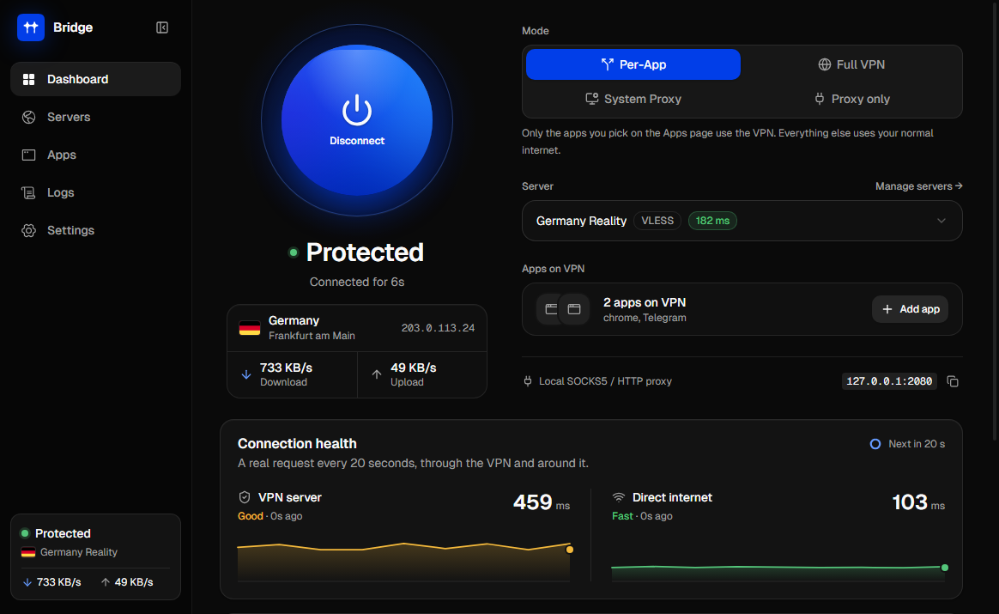
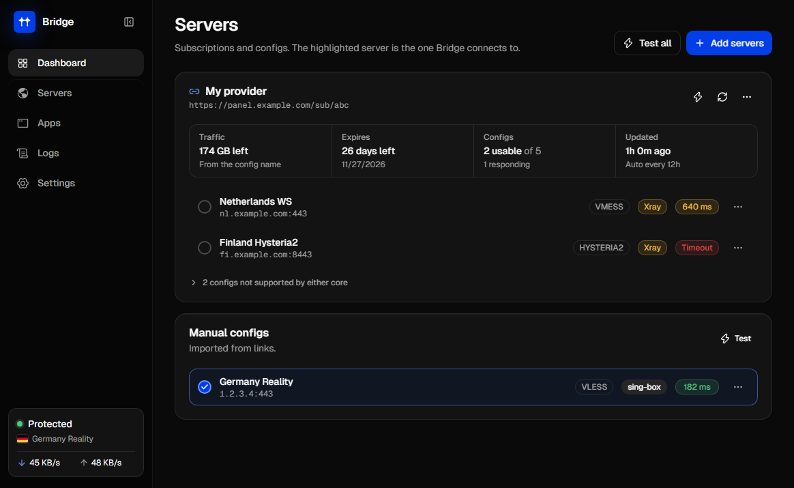
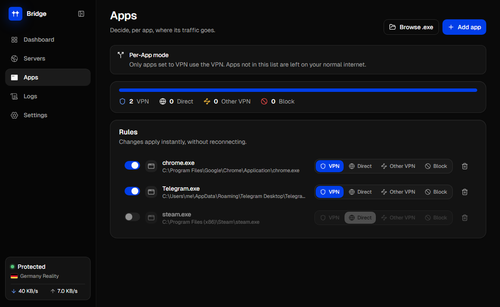
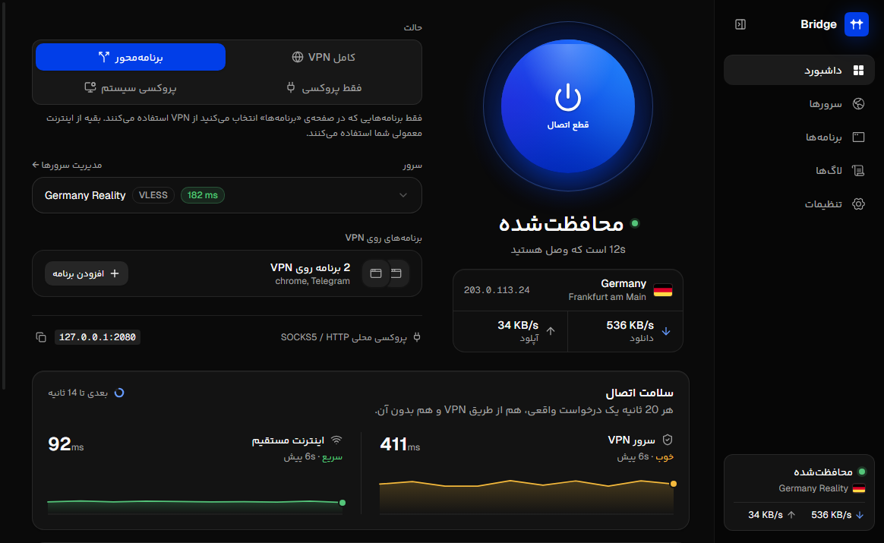

# Bridge

**English** · [فارسی](README.fa.md)

A Windows VPN client with **per-app routing**: you pick which apps go through the VPN, and everything else keeps using your normal internet. In English and Persian.



## Download

Get the latest installer from [Releases](https://github.com/m4hdisa/Bridge-app/releases/latest) (`Bridge.Setup.x.y.z.exe`, Windows 10/11, x64). Install over an older version to update; your servers and settings are kept. After that, Bridge updates itself: it shows **Install and restart** when a new version is out.

Per-App and Full VPN modes need administrator rights. Bridge offers a "Restart as admin" button when needed.

## Features

- **Protocols:** VLESS (Reality, XTLS Vision, xhttp, VLESS Encryption), VMess, Trojan, Shadowsocks, Hysteria2, TUIC.
- **Two cores:** [sing-box](https://github.com/SagerNet/sing-box) runs everything it supports, and [Xray-core](https://github.com/XTLS/Xray-core) takes over the configs sing-box can't run (xhttp, VLESS Encryption, HTTP header over TCP). Bridge picks the core automatically, and you can change it per server.
- **Free WARP server:** no config needed. Bridge connects to Cloudflare WARP through the [Aether](https://github.com/CluvexStudio/Aether) core, trying several methods at once (Gool, MASQUE over HTTP/3 or HTTP/2, TLS fragment, IPv6). It prefers Gool for an exit outside Iran, and creates the WARP account through one of your own servers when Cloudflare's WARP service is blocked. **Find configs** tests every method once and saves the ones that work, so later connects take seconds.
- **Four connection modes:**
  - **Per-App**: only the apps you choose use the VPN.
  - **Full VPN**: the whole system goes through the VPN.
  - **System Proxy**: sets the Windows proxy.
  - **Proxy only**: a local SOCKS5/HTTP proxy on `127.0.0.1:2080`, with no system changes.
- **App rules:** set each app to VPN, Direct, Other VPN (handed to another VPN tool already running, such as a game booster) or Block. Changes apply instantly, without reconnecting.
- **Subscriptions:** shows traffic left, days left and config count, and updates automatically. When a panel doesn't send usage headers, Bridge reads usage from the config names.
- **Works next to other VPN tools:** detects other tunnels (WARP, game VPNs such as EZConnect) and keeps out of their way.
- **Iranian sites go direct** (`.ir` and the Iran geoip/geosite lists).
- **Auto server:** pings every server in the background. **Auto (best ping)** connects to the fastest one and moves to another if it stops responding.
- **Live status:** what Bridge is doing while it connects, real latency tests, health charts for the VPN and the direct internet, the VPN exit location with its flag, live speed and per-app traffic.
- **Discord activity:** shows your connection (server, mode, exit country with its flag) on your Discord profile. Your IP address is never shown. Can be turned off in Settings.
- **English and Persian:** the whole interface, right to left in Persian.
- **Updates:** Bridge checks this repository's releases and installs a new version in one click.

| Servers | Apps |
|---|---|
|  |  |



## Build from source

Requires Node.js 22+ on Windows.

```bash
npm install
npm run fetch-core   # downloads sing-box, Xray, Aether and the Iran rule-sets into resources/
npm run dev          # run the app
npm run dist         # build the installer into dist/
```

`npm run dev:ui` runs the interface in a normal browser with a fake backend, so you can work on the UI without touching the network.

Tests (they don't change any network settings):

```bash
npm run typecheck
npm run selftest
```

## Third-party software

The installer bundles these programs. They are downloaded at build time and are not part of this repository:

- [sing-box](https://github.com/SagerNet/sing-box), GPL-3.0-or-later. Source: https://github.com/SagerNet/sing-box
- [Xray-core](https://github.com/XTLS/Xray-core), MPL-2.0. Source: https://github.com/XTLS/Xray-core
- [Aether](https://github.com/CluvexStudio/Aether) by CluvexStudio ([Telegram](https://t.me/CluvexStudio)), AGPL-3.0, for the free WARP server. Bridge runs the official `aether.exe` unmodified, as a separate program. Source: https://github.com/CluvexStudio/Aether
- [Iran sing-box rule-sets](https://github.com/Chocolate4U/Iran-sing-box-rules) by Chocolate4U.

The app is built with [Electron](https://www.electronjs.org/), React, Tailwind CSS and [shadcn/ui](https://ui.shadcn.com/). Its fonts are [Geist and Geist Mono](https://github.com/vercel/geist-font) by Vercel, SIL Open Font License 1.1 (`src/renderer/src/assets/fonts/Geist-OFL.txt`). The sidebar icons are [Phosphor](https://phosphoricons.com/) (MIT); the rest are [Lucide](https://lucide.dev/) (ISC).

The Persian interface uses **Yekan Bakh** by Reza Bakhtiarifard ([fontiran.com](https://fontiran.com)), a commercial font licensed for the official builds. It is not part of this repository: builds without it (`src/renderer/public/fonts/yekan-bakh/`) fall back to the system font.

## License

Bridge is licensed under the [GNU General Public License v3.0](LICENSE).
