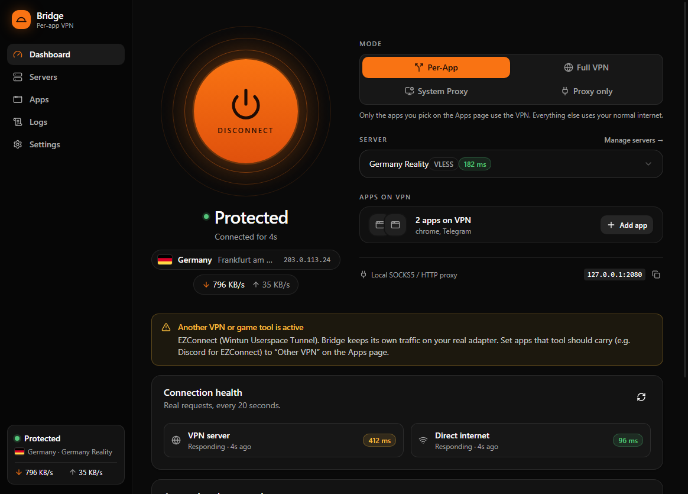
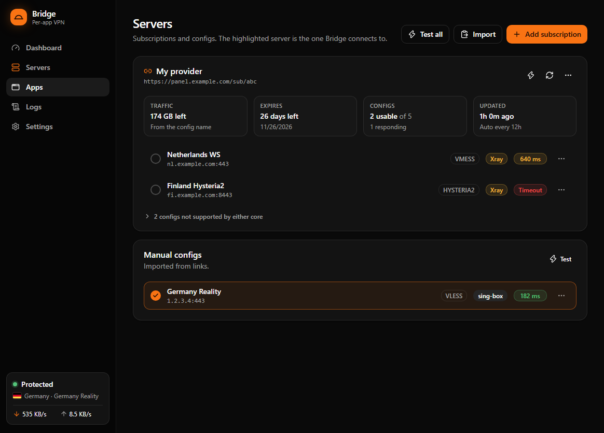
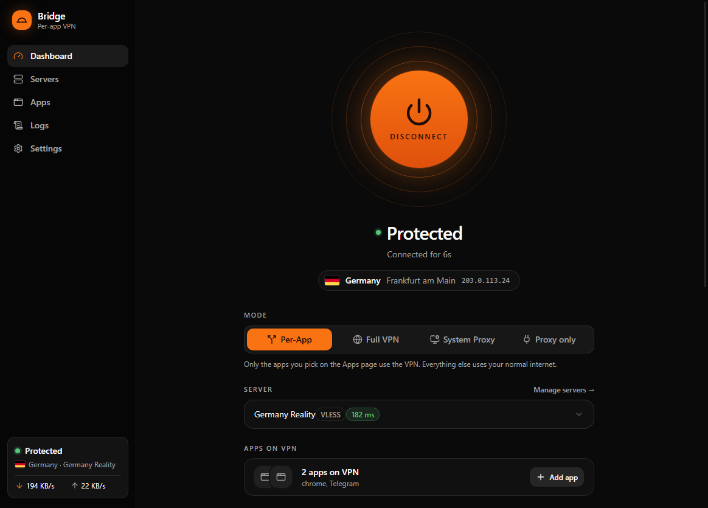
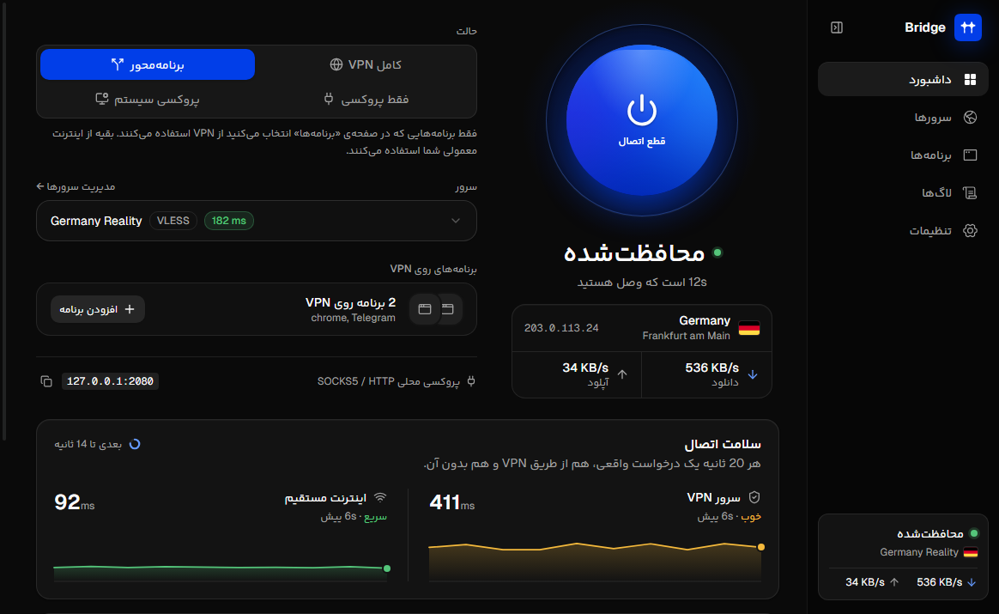

# Bridge

**English** · [فارسی](README.fa.md)

A Windows VPN client with **per-app routing**: you pick which apps go through the VPN, and everything else keeps using your normal internet. In English and Persian.



## Download

Get the latest installer from [Releases](https://github.com/m4hdisa/Bridge-app/releases/latest) (`Bridge.Setup.x.y.z.exe`, Windows 10/11, x64). Install over an older version to update; your servers and settings are kept. After that, Bridge updates itself: it shows **Install and restart** when a new version is out.

**Android:** [Bridge for Android](https://github.com/m4hdisa/Bridge-Android) (its [releases](https://github.com/m4hdisa/Bridge-Android/releases), also posted here as `android-v…`), with Free WARP, Xray configs and a dashboard with a map. `arm64-v8a` is for almost every phone.

Per-App and Full VPN modes need administrator rights. Bridge offers a "Restart as admin" button when needed.

## Features

- **Protocols:** VLESS (Reality, XTLS Vision, xhttp, VLESS Encryption), VMess, Trojan, Shadowsocks, Hysteria2, TUIC.
- **Two cores:** [sing-box](https://github.com/SagerNet/sing-box) runs everything it supports, and [Xray-core](https://github.com/XTLS/Xray-core) takes over the configs sing-box can't run (xhttp, VLESS Encryption, HTTP header over TCP). Bridge picks the core automatically, and you can change it per server.
- **Free WARP server:** no config needed. Bridge connects to Cloudflare WARP through the [Aether](https://github.com/CluvexStudio/Aether) core, trying several methods at once (MASQUE over HTTP/3 or HTTP/2, TLS fragment, IPv6, and with two hops Gool and MASQUE in MASQUE). A single tunnel from Iran usually gets an exit in Iran. Choose **Auto: fastest**, or **Auto: exit outside Iran**, which waits for the slower ways with two hops. It creates the WARP account through one of your own servers when Cloudflare's WARP service is blocked. **Find configs** tests every method, looks for several gateways and measures each one's speed, so later connects take seconds. **Share with someone** copies a link with a WARP account of its own, so a friend who can't reach Cloudflare's sign-up service can still connect: they copy it and choose Add servers, Links from clipboard.
- **WARP + Psiphon for an exit outside Iran:** from Iran, WARP usually exits in Iran even with two hops. Choose **WARP + Psiphon** as the connection method on the Free WARP card to carry Psiphon inside WARP and leave from another country, which you can choose next to it. It is slower, takes longer to connect, and calls and games that use UDP may not work.
- **Your own WARP+ key:** if you have a WARP+ subscription, press the key icon on the Free WARP card and enter the key from the 1.1.1.1 app. It goes only to Cloudflare and Bridge doesn't keep it. WARP+ can be faster, but it doesn't make WARP harder to block.
- **More kinds of subscription:** besides share links, Bridge reads whole Xray, sing-box and Clash config files in JSON, keeping fragment settings. For a [BPB Panel](https://github.com/bia-pain-bache/BPB-Worker-Panel), you can add any of its subscription links or just the panel's own address. WireGuard-only subscriptions aren't imported.
- **Free public configs (off until you turn them on):** Add servers, Free public configs downloads [a list rebuilt and tested every day](https://github.com/m4hdisa/Bridge-configs) and other public lists from GitHub, tests about 400 configs on your own network and keeps up to 8, fastest first, that really carry HTTPS, leave outside Iran and answer steadily. **Nobody knows who runs these servers.** They can see your IP address and which sites you open, so use them to get online and for ordinary browsing, not for logins or anything sensitive. Auto only uses them if you have no server of your own. Configs behind Cloudflare come from [a second daily list](https://github.com/m4hdisa/Bridge-configs) moved onto a Cloudflare address that answers from Iran, an idea from [patterniha/Free-Configs](https://github.com/patterniha/Free-Configs). Lists: [barry-far](https://github.com/barry-far/V2ray-Config), [MatinGhanbari](https://github.com/MatinGhanbari/v2ray-configs), [Danialsamadi](https://github.com/Danialsamadi/v2go), [Rayan-Config](https://github.com/Rayan-Config/C-Sub), [TGParse](https://github.com/Surfboardv2ray/TGParse), [hamedcode](https://github.com/hamedcode/port-based-v2ray-configs), [nyeinkokoaung404](https://github.com/nyeinkokoaung404/V2ray-Configs), [V2RayAggregator](https://github.com/mahdibland/V2RayAggregator).
- **Four connection modes:**
  - **Per-App**: only the apps you choose use the VPN. With the optional Per-App driver (one click on the Apps page) it works like Proxifier: no VPN adapter, so connecting, disconnecting or switching servers never interrupts other apps, such as games.
  - **Full VPN**: the whole system goes through the VPN.
  - **System Proxy**: sets the Windows proxy.
  - **Proxy only**: a local SOCKS5/HTTP proxy on `127.0.0.1:2080`, with no system changes.
- **Switching servers without reconnecting:** servers that answered their last test are kept ready, so picking another one while connected moves the VPN at once.
- **App rules:** set each app to VPN, Direct, Other VPN (handed to another VPN tool already running, such as a game booster) or Block. Changes apply instantly, without reconnecting.
- **Subscriptions:** shows traffic left, days left and config count, and updates automatically. When a panel doesn't send usage headers, Bridge reads usage from the config names.
- **Works next to other VPN tools:** the defaults suit a PC with no other VPN or game tool open. When Bridge detects one (WARP, game VPNs such as EZConnect), it keeps its own traffic out of their way, and one click on the Dashboard switches to settings compatible with them.
- **Iranian sites go direct** (`.ir` and the Iran geoip/geosite lists).
- **Auto server:** pings every server in the background. **Auto (best ping)** connects to the fastest one and moves to another if it stops responding.
- **Tools:** a speed test that also shows how much the VPN adapter costs, and an MTU finder for your line. The speed test contacts Cloudflare (speed.cloudflare.com) only when you start it.
- **Live status:** what Bridge is doing while it connects, real latency tests, health charts for the VPN and the direct internet, the VPN exit location with its flag, live speed and per-app traffic.
- **Discord activity:** shows your connection (server, mode, exit country with its flag) on your Discord profile. Your IP address is never shown. Can be turned off in Settings.
- **English and Persian:** the whole interface, right to left in Persian.
- **Updates:** Bridge checks this repository's releases and installs a new version in one click.

| Servers | Apps |
|---|---|
|  |  |



## Build from source

Requires Node.js 22+ and Go 1.26+ on Windows (put `go` on PATH, or set `GO` to its `go.exe`).

```bash
npm install
npm run fetch-core   # downloads sing-box, Xray, Aether, the Per-App driver and the Iran rule-sets into resources/, builds bridge-perapp.exe
npm run dev          # run the app
npm run dist         # build the installers into dist/
```

`npm run dist` makes two installers. `Bridge Setup <version>.exe` is the one people download: Bridge's own window (`native/setup`, on Windows' WebView2 through [go-webview2](https://github.com/jchv/go-webview2), MIT) with the second one inside it, which it runs silently. `Bridge-Update-<version>.exe` is electron-builder's installer, which `latest.yml` points at, so updates download it and install it as before; it also runs on its own pages on PCs without WebView2.

`npm run dev:ui` runs the interface in a normal browser with a fake backend, so you can work on the UI without touching the network.

Tests (they don't change any network settings):

```bash
npm run typecheck
npm run selftest
```

## Third-party software

The installer bundles these programs. They are downloaded at build time and are not part of this repository:

- [sing-box](https://github.com/SagerNet/sing-box), GPL-3.0-or-later. Source: https://github.com/SagerNet/sing-box
- [Xray-core](https://github.com/XTLS/Xray-core), MPL-2.0. Source: https://github.com/XTLS/Xray-core
- [Aether](https://github.com/CluvexStudio/Aether) by CluvexStudio ([Telegram](https://t.me/CluvexStudio)), AGPL-3.0, for the free WARP server, with [Psiphon](https://github.com/Psiphon-Labs/psiphon-tunnel-core) (GPL-3.0) from the same Aether release for WARP + Psiphon. Bridge runs the official `aether.exe` and `psiphon-tunnel-core.exe` unmodified, as a separate program. Source: https://github.com/CluvexStudio/Aether
- [Iran sing-box rule-sets](https://github.com/Chocolate4U/Iran-sing-box-rules) by Chocolate4U.

For Per-App without the VPN adapter, Bridge has its own `bridge-perapp.exe` (source in `native/perapp`, built with Go 1.26 or newer by `scripts/fetch-core.mjs`), which hands only the chosen apps' connections to Bridge. It is built on [ndisapi-go](https://github.com/wiresock/ndisapi-go) (MIT), the Go library of the [Windows Packet Filter](https://www.ntkernel.com/windows-packet-filter/) driver, and its ProxiFyre example. The installer includes that driver, 3.6.2.1 by NT KERNEL (freeware for non-commercial use; its EULA allows including it in free products and ships with it), unmodified and checked against a pinned SHA-256 hash, and offers to install it on its own page (the Apps page offers the same later), with no download. It stays out of Windows' list of installed apps and goes when Bridge is uninstalled; no other program or service is added. Licenses are in `resources/perapp`.

The app is built with [Electron](https://www.electronjs.org/), React, Tailwind CSS and [shadcn/ui](https://ui.shadcn.com/). Its fonts are [Geist and Geist Mono](https://github.com/vercel/geist-font) by Vercel, SIL Open Font License 1.1 (`src/renderer/src/assets/fonts/Geist-OFL.txt`). The sidebar icons are [Phosphor](https://phosphoricons.com/) (MIT); the rest are [Lucide](https://lucide.dev/) (ISC).

The Persian interface uses **Yekan Bakh** by Reza Bakhtiarifard ([fontiran.com](https://fontiran.com)), a commercial font licensed for the official builds. It is not part of this repository: builds without it (`src/renderer/public/fonts/yekan-bakh/`) fall back to the system font.

## License

Bridge is licensed under the [GNU General Public License v3.0](LICENSE).
